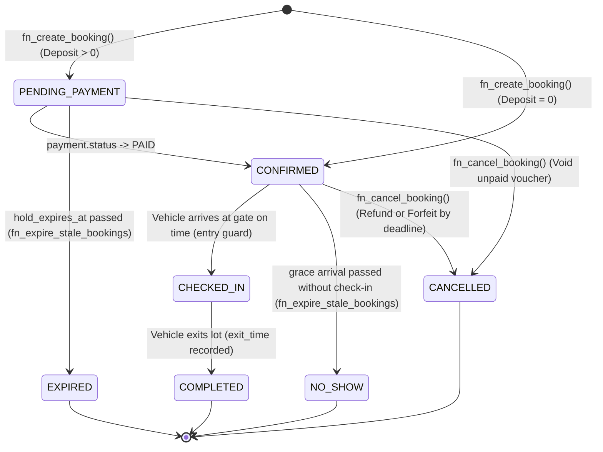
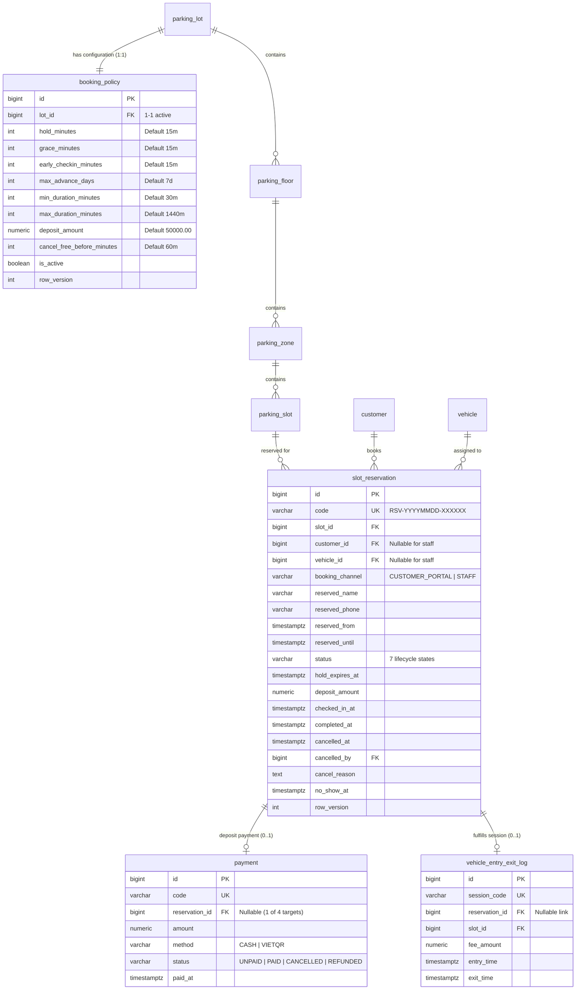

# Advance Slot Booking Management — Technical & Business Specification

**Document Identifier**: `docs/requirements/08-booking-requirements.md`  
**Module**: Advance Slot Booking Management Module (M4/M5/M6)  
**Target Platform**: PostgreSQL 18.6 (Database Authority) & Plain-Python Backend Services  
**Compliance Standards**: OQ-87 through OQ-94, TL-04, TL-14, TL-15, TL-25, TL-38, TL-39, TL-42  

---

## 1. Architectural Overview & Objectives

The **Advance Slot Booking Management** module allows registered customers (via Customer Portal) and counter staff to reserve parking slots in advance for standard cars (`CAR`) and electric vehicles (`EV`). Because the backend adopts a Plain-Python architecture without an ORM, all mission-critical business constraints, temporal guards, exclusion locks, deposit accounting, and state transition validations reside natively within the PostgreSQL 18.6 database layer.

### Core Objectives:
1. **Zero Double-Booking Guarantee**: Utilize PostgreSQL GiST exclusion constraints (`btree_gist`) to mathematically guarantee no temporal overlap across holding reservations for the same slot or vehicle.
2. **Flexible Policy Governance**: Decouple lot policy configuration into a dedicated `booking_policy` table (1-to-1 with `parking_lot`), supporting fine-grained deposit amounts, hold deadlines, grace periods, and cancellation thresholds.
3. **Integrated Deposit Settlement**: Link reservation deposits seamlessly with the unified `payment` ledger (`ck_payment_single_target`), providing automated status transitions and precise `NUMERIC` fee deduction upon vehicle check-out.
4. **Autonomous Sweeper**: Provide an idempotent PL/pgSQL sweeper routine (`fn_expire_stale_bookings`) to transition unpaid holds to `EXPIRED` and unfulfilled bookings past grace arrival to `NO_SHOW`.

---

## 2. Reservation Lifecycle & State Transition Diagram

The advance reservation lifecycle comprises exactly **7 states**:
- `PENDING_PAYMENT`: Initial hold state when a positive deposit is required. Holds the slot for `hold_minutes` while awaiting deposit payment.
- `CONFIRMED`: Active valid booking state (either zero deposit required or deposit has been successfully paid). The slot is protected and marked `RESERVED` during the booking window.
- `CHECKED_IN`: Customer vehicle has arrived at the barrier gate within `[reserved_from - early_checkin_minutes, reserved_from + grace_minutes]`, barrier opens, and an open session is linked.
- `COMPLETED`: Vehicle has exited the facility, check-out fee settled (with deposit deducted), and session closed. **(Terminal State)**
- `CANCELLED`: Booking cancelled by customer or staff. Deposit refunded if cancelled before deadline; forfeited if cancelled late. **(Terminal State)**
- `EXPIRED`: Hold period elapsed without deposit payment (`CURRENT_TIMESTAMP > hold_expires_at`). Slot released automatically. **(Terminal State)**
- `NO_SHOW`: Vehicle failed to arrive within the permitted grace arrival window (`CURRENT_TIMESTAMP > reserved_from + grace_minutes`). Deposit forfeited. **(Terminal State)**



### State Transition Rules & Guards:
- **Holding States**: `PENDING_PAYMENT`, `CONFIRMED`, `CHECKED_IN`. These three states activate the GiST exclusion constraint, blocking any other booking on the slot or by the vehicle.
- **Terminal States**: `COMPLETED`, `CANCELLED`, `EXPIRED`, `NO_SHOW`. Once a reservation enters a terminal state, it can never transition to any other status.
- **Soft-Delete Guard**: Deleting a reservation while in a holding state is blocked (`PROP-DEL-RSV-ACTIVE`). Reservations must be in terminal states to be soft-deleted.

---

## 3. Entity-Relationship Model (Mermaid ERD)



---

## 4. Business Rules & Mathematical Calculations

### 4.1. Policy Configuration (`OQ-87`)
Each `parking_lot` is linked 1-to-1 with an active `booking_policy` record. Standard defaults:
- `hold_minutes = 15`: Window allowed for deposit payment before reservation expires.
- `grace_minutes = 15`: Late arrival tolerance after `reserved_from` before reservation becomes `NO_SHOW`.
- `early_checkin_minutes = 15`: Early arrival tolerance before `reserved_from` allowing entry.
- `max_advance_days = 7`: Maximum days in advance a reservation may be booked.
- `min_duration_minutes = 30` & `max_duration_minutes = 1440` (24 hours).
- `deposit_amount = 50,000.00` VND.
- `cancel_free_before_minutes = 60`: Minimum lead time before `reserved_from` to qualify for a full deposit refund.

### 4.2. Deposit Application & Check-Out Deduction (`OQ-89`)
At barrier check-out, the parking fee calculation is executed atomically in `NUMERIC(12,2)` precision:
$$\text{nominal\_fee} = \text{fn\_calculate\_parking\_tariff}(\text{entry\_time}, \text{exit\_time}, \text{vehicle\_type})$$
$$\text{actual\_fee} = \max(0.00, \text{nominal\_fee} - \text{deposit\_amount})$$
- If `nominal_fee <= deposit_amount`, `actual_fee = 0.00` (no additional payment required at barrier).
- If `nominal_fee > deposit_amount`, customer pays the remaining balance `actual_fee`.
- All deposit revenue with status `PAID` is aggregated into `v_revenue_today_by_method` under fiscal accounting standards.

### 4.3. Cancellation & Refund Policy (`OQ-90`)
$$\text{deadline} = \text{reserved\_from} - (\text{cancel\_free\_before\_minutes} \times \text{interval '1 minute'})$$
- **On-Time Cancellation** (`CURRENT_TIMESTAMP <= deadline`):
  - Reservation status $\to$ `CANCELLED`.
  - Deposit payment status $\to$ `REFUNDED` (100% refund).
- **Late Cancellation** (`CURRENT_TIMESTAMP > deadline`):
  - Reservation status $\to$ `CANCELLED`.
  - Deposit payment status remains `PAID` (forfeited). Note added: `"Tịch thu cọc: Hủy sau deadline"`.
- **Unpaid Cancellation** (`status = 'PENDING_PAYMENT'`):
  - Reservation status $\to$ `CANCELLED`.
  - Deposit payment status $\to$ `CANCELLED`.

---

## 5. Database API Integration Guide for Python Backend Developers

Since the project operates without an ORM, backend services communicate with PostgreSQL through standardized procedural functions and analytical views.

### 5.1. Find Available Slots: `fn_find_available_slots()`

**Purpose**: Searches for slots in a given parking lot eligible for reservation in the desired time window.

```sql
SELECT * FROM fn_find_available_slots(
    p_lot_id          => 1::BIGINT,
    p_vehicle_type_id => 1::BIGINT,
    p_from            => '2026-10-25 08:00:00+07'::TIMESTAMPTZ,
    p_until           => '2026-10-25 12:00:00+07'::TIMESTAMPTZ,
    p_floor_id        => NULL::BIGINT  -- Optional filter
);
```

**Returned Columns**:
- `slot_id` (BIGINT), `slot_code` (VARCHAR), `slot_kind` (VARCHAR)
- `zone_id` (BIGINT), `zone_code` (VARCHAR), `zone_name` (VARCHAR)
- `floor_id` (BIGINT), `floor_code` (VARCHAR), `floor_name` (VARCHAR)

**Internal Safety Filters**:
- Excludes slots in `MAINTENANCE` status.
- Validates vehicle type compatibility via `slot_allowed_vehicle_type`.
- Excludes slots with overlapping reservations in `PENDING_PAYMENT`, `CONFIRMED`, or `CHECKED_IN` (Index Scan on GiST).
- Excludes slots with overlapping active subscription tickets.
- Excludes slots occupied by open parking sessions when the window intersects current time.

---

### 5.2. Create Advance Booking: `fn_create_booking()`

**Purpose**: Creates a booking record, validates policies, handles GiST concurrency races, and generates the deposit payment voucher.

```sql
SELECT fn_create_booking(
    p_lot_id           => 1::BIGINT,
    p_customer_id      => 5::BIGINT,
    p_vehicle_id       => 3::BIGINT,
    p_slot_id          => 42::BIGINT,
    p_reserved_from    => '2026-10-25 08:00:00+07'::TIMESTAMPTZ,
    p_reserved_until   => '2026-10-25 12:00:00+07'::TIMESTAMPTZ,
    p_booking_channel  => 'CUSTOMER_PORTAL',  -- or 'STAFF'
    p_reserved_name    => NULL,               -- Required if staff booking without customer_id
    p_reserved_phone   => NULL,               -- Required if staff booking without customer_id
    p_notes            => 'Khách đặt trước chỗ đỗ xe',
    p_created_by       => 1::BIGINT           -- Account ID of actor
);
```

**Return Value**: `BIGINT` (ID of the newly created `slot_reservation`).

**Python Error Handling (`PROP-*` Exception Mapping)**:
```python
import psycopg
from psycopg.errors import CheckViolation

try:
    with conn.cursor() as cur:
        cur.execute("SELECT fn_create_booking(%s, %s, %s, %s, %s, %s, %s, %s, %s, %s, %s)", (...))
        reservation_id = cur.fetchone()[0]
except CheckViolation as exc:
    hint = exc.diag.message_hint
    if hint == 'PROP-BOOK-RESERVE-IN-PAST':
        # HTTP 400 Bad Request
        return {"error": "Thời gian bắt đầu đặt chỗ không được ở trong quá khứ."}
    elif hint == 'PROP-BOOK-SLOT-ALREADY-TAKEN':
        # HTTP 409 Conflict
        return {"error": "Vị trí đỗ xe này đã có người đặt trước trong khung giờ đã chọn."}
    elif hint == 'PROP-BOOK-VEHICLE-DOUBLE-BOOKING':
        # HTTP 409 Conflict
        return {"error": "Phương tiện này đã có một lịch đặt chỗ khác trùng lặp về thời gian."}
    elif hint == 'PROP-BOOK-CUSTOMER-BLACKLISTED':
        # HTTP 403 Forbidden
        return {"error": "Khách hàng đang trong danh sách đen (BLACKLISTED), không thể thực hiện đặt chỗ."}
```

---

### 5.3. Cancel Advance Booking: `fn_cancel_booking()`

**Purpose**: Cancels an active booking, enforcing cancellation refund deadlines or deposit forfeiture.

```sql
SELECT fn_cancel_booking(
    p_reservation_id => 101::BIGINT,
    p_cancelled_by   => 1::BIGINT,
    p_cancel_reason  => 'Khách bận lịch đột xuất'
);
```

**Return Value** (`JSONB`):
```json
{
  "reservation_id": 101,
  "status": "CANCELLED",
  "refund_eligible": true,
  "refund_amount": 50000.00,
  "cancelled_at": "2026-10-24T15:30:00+07:00"
}
```

---

### 5.4. Sweeper Routine: `fn_expire_stale_bookings()`

**Purpose**: Sweeps expired holds and no-show bookings. Designed to be called periodically (e.g., every 60 seconds) by an external Python cron or background worker.

```sql
SELECT fn_expire_stale_bookings();
```

**Return Value**: `INTEGER` (Total count of bookings updated in this run).  
**Idempotency**: Running twice in succession without time change returns `0`. Safe for high-frequency execution.

---

### 5.5. Analytical Overview View: `v_booking_overview`

**Purpose**: Master denormalized view exposing booking codes, customer info, vehicle data, slot hierarchy, deposit payments, and remaining hold times.

```sql
-- Query active reservations for a specific floor
SELECT 
    reservation_code,
    customer_name,
    customer_phone,
    license_plate,
    slot_code,
    reserved_from,
    reserved_until,
    reservation_status,
    deposit_amount,
    payment_status
FROM v_booking_overview
WHERE lot_id = 1 
  AND floor_code = 'B1'
  AND reservation_status IN ('PENDING_PAYMENT', 'CONFIRMED', 'CHECKED_IN')
ORDER BY reserved_from ASC;
```

---

## 6. Error Code Reference Catalog (`PROP-BOOK-*`)

| Error Code | HTTP Status | Description | User-Facing Vietnamese Message |
|---|:---:|---|---|
| `PROP-BOOK-RESERVE-IN-PAST` | 400 | Start time in past | `Thời gian bắt đầu đặt chỗ không được ở trong quá khứ.` |
| `PROP-BOOK-MIN-DURATION` | 400 | Duration under min | `Thời lượng đặt chỗ ngắn hơn mức tối thiểu quy định.` |
| `PROP-BOOK-MAX-DURATION` | 400 | Duration over max | `Thời lượng đặt chỗ vượt quá mức tối đa quy định.` |
| `PROP-BOOK-MAX-ADVANCE` | 400 | Lead time over max | `Thời gian đặt chỗ vượt quá số ngày đặt trước tối đa cho phép.` |
| `PROP-BOOK-CUSTOMER-BLACKLISTED` | 403 | Customer blacklisted | `Khách hàng đang trong danh sách đen (BLACKLISTED), không thể thực hiện đặt chỗ.` |
| `PROP-BOOK-PLATE-BLACKLISTED` | 403 | Plate blacklisted | `Biển số xe đang trong danh sách đen, không thể đặt chỗ.` |
| `PROP-BOOK-SLOT-VEHICLE-TYPE-MISMATCH` | 400 | Incompatible slot type | `Vị trí đỗ xe này không hỗ trợ loại phương tiện đã chọn.` |
| `PROP-BOOK-SLOT-ALREADY-TAKEN` | 409 | Slot overlap race | `Vị trí đỗ xe này đã có người đặt trước trong khung giờ đã chọn.` |
| `PROP-BOOK-VEHICLE-DOUBLE-BOOKING` | 409 | Vehicle overlap race | `Phương tiện này đã có một lịch đặt chỗ khác trùng lặp về thời gian.` |
| `PROP-BOOK-ENTRY-EARLY` | 400 | Arrived too early | `Phương tiện đến quá sớm so với khung giờ đặt trước cho phép.` |
| `PROP-BOOK-ENTRY-LATE` | 400 | Arrived after grace | `Lịch đặt chỗ đã quá hạn thời gian ân hạn đón khách (grace period).` |
| `PROP-BOOK-CANCEL-INVALID-STATUS` | 400 | Cannot cancel status | `Không thể hủy đặt chỗ ở trạng thái hiện tại (chỉ cho phép hủy khi đang PENDING_PAYMENT hoặc CONFIRMED).` |
| `PROP-BOOK-STATUS-TRANSITION` | 400 | Invalid status transition | `Chuyển đổi trạng thái đặt chỗ không hợp lệ.` |
| `PROP-BOOK-TERMINAL-IMMUTABLE` | 400 | Terminal status immutable | `Đặt chỗ ở trạng thái kết thúc không thể chuyển sang trạng thái khác.` |
| `PROP-BOOK-TERMINAL-FIELDS-IMMUTABLE` | 400 | Terminal fields immutable | `Không thể chỉnh sửa thông tin lịch đặt chỗ đã ở trạng thái kết thúc.` |
| `PROP-DEL-RSV-ACTIVE` | 400 | Soft-delete active booking | `Không thể xóa đặt chỗ đang có hiệu lực. Vui lòng hủy đặt chỗ trước khi xóa.` |
| `PROP-RESTORE-BOOKING-POLICY` | 400 | Duplicate active policy | `Bãi đỗ xe đã có chính sách đặt chỗ đang hoạt động, không thể khôi phục thêm.` |
